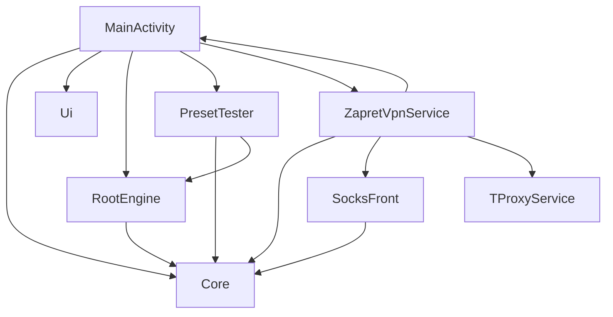
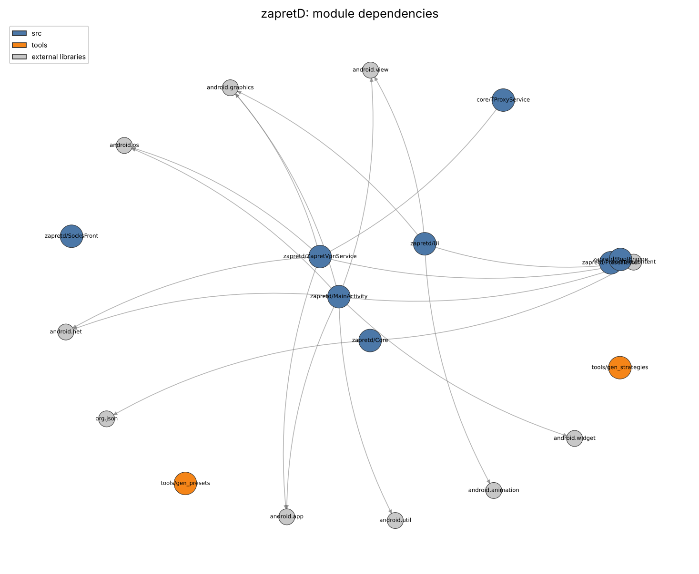

# Zapret for Android (ZFA) / zapretD

[](LICENSE)

Репозиторий: https://github.com/ZapretD-android/ZapretD

---

## Русский

zapretD — Android-приложение на Kotlin для обхода DPI-блокировок Discord и YouTube. Интерфейс в стиле Material Design 3, тёмная и светлая тема.

Основано на пресетах [zapret-discord-youtube](https://github.com/flowseal/zapret-discord-youtube) для Windows: `general`, `general (ALT)`, `SIMPLE FAKE`, `FAKE TLS AUTO` и другие, всего 22 варианта.

Статус. Режим Root проверен на реальном телефоне: YouTube и Discord работают. Режим VPN без root работает хуже — причины описаны ниже. Если что-то не работает, откройте Issue и приложите журнал из приложения.

### Два режима

| | Root | VPN без root |
|---|---|---|
| Что запускается | `nfqws` из zapret + правила iptables (NFQUEUE) | ByeDPI + hev-socks5-tunnel через `VpnService` |
| Пресеты | Те же аргументы, что в `.bat` для Windows, без изменений | 15 собственных стратегий ByeDPI |
| Подмена пакетов (seqovl, fooling, fake с TTL) | Да | Нет, только приёмы на уровне сокета |
| UDP (QUIC, голос Discord) | Обрабатывается | Не обрабатывается: QUIC отбрасывается, браузер переходит на TCP |
| Требования | Root, ядро с поддержкой NFQUEUE | Android 9+ |

Режим VPN не может повторить `winws` с ПК: на Android без root нельзя подделывать TCP-пакеты. Если у вас есть root, используйте его.

### Возможности

- Переключатели сервисов: Discord, YouTube, другие сайты из списка.
- Выбор из 22 пресетов zapret (Root) или 15 стратегий ByeDPI (VPN).
- Кнопка «Подобрать лучший пресет»: перебирает варианты, показывает `Discord 2/2 · YouTube 1/2 · 140 мс`, причину каждой неудачи и замер «без обхода».
- Журнал работы прямо в приложении.
- Собственный DNS-слой для режима VPN: статический ByeDPI не умеет резолвить домены на Android.
- Android 9 и новее (API 28), архитектуры `arm64-v8a` и `armeabi-v7a`.

### Установка

Соберите APK сами (ниже) или возьмите готовый из [раздела Releases](https://github.com/ZapretD-android/ZapretD/releases). Разрешите установку из неизвестных источников. APK подписан отладочным ключом.

### Сборка

Скачайте исходники:

```bash
git clone https://github.com/ZapretD-android/ZapretD.git
cd ZapretD
```

Нужны JDK 11+, компилятор Kotlin, Android SDK (build-tools и платформа API 28 или новее). Готовые бинарники лежат в `lib/`.

Linux, macOS:

```bash
./build.sh
```

Debian и Ubuntu без Android SDK:

```bash
sudo apt install default-jdk-headless kotlin aapt zipalign apksigner dalvik-exchange libandroid-23-java
./build.sh
```

Windows:

```bat
set ANDROID_HOME=C:\Users\ВАШ_ПОЛЬЗОВАТЕЛЬ\AppData\Local\Android\Sdk
build.bat
```

`kotlinc` и JDK должны быть в `PATH`. Результат: `build\zapretD.apk`. Свой путь: `./build.sh out/app.apk`.

`build.sh` проверен на Ubuntu. `build.bat` написан по тому же сценарию, но на Windows не запускался. Если сломается — откройте Issue или сделайте Pull Request.

Переменные окружения: `ANDROID_HOME`, `ANDROID_JAR`, `KOTLIN_STDLIB`, `KEYSTORE`, `KEYSTORE_PASS`, `KEY_ALIAS`. Для релиза подставьте свой ключ через `KEYSTORE`.

### Бинарники и пресеты

В `lib/` лежат `nfqws`, `ciadpi` и `libhev-socks5-tunnel.so`. Скачать их заново:

```bash
tools/fetch_binaries.sh
```

Обновить пресеты из новой версии zapret-discord-youtube:

```bash
python3 tools/gen_presets.py путь/к/zapret-discord-youtube
python3 tools/gen_strategies.py
```

Первый скрипт читает `.bat`-файлы, убирает параметры WinDivert и игровые фильтры, делит их на сегменты Discord, YouTube и общий список. Второй пишет список стратегий ByeDPI.

### Как устроено



| Файл | Что делает |
|---|---|
| `Core.kt` | Настройки, журнал, загрузка пресетов и списков доменов |
| `RootEngine.kt` | Запуск `nfqws` через `su`, правила iptables, остановка |
| `ZapretVpnService.kt` | VPN-служба: запускает ByeDPI, SOCKS-слой и туннель |
| `SocksFront.kt` | SOCKS5-сервер между туннелем и ByeDPI: резолвит DNS, отдаёт UDP, режет QUIC |
| `TProxyService.kt` | Привязка к нативной библиотеке hev-socks5-tunnel |
| `PresetTester.kt` | Подбор пресета: TLS-запросы к целям с замером времени |
| `Ui.kt`, `MainActivity.kt` | Интерфейс |

Граф зависимостей:



```
.
├── AndroidManifest.xml
├── assets/     presets.json, strategies.json, списки доменов, bin-файлы для fake
├── lib/        нативные бинарники для arm64-v8a и armeabi-v7a
├── res/
├── src/        исходный код на Kotlin
├── tools/      генераторы пресетов, скачивание бинарников
├── docs/
├── build.sh
└── build.bat
```

### Известные ограничения

- Подбор проверяет простым TLS-запросом. Браузерный ClientHello больше — пресет может пройти подбор и всё равно не открыть сайт.
- В режиме VPN работает только IPv4.
- Строгий Private DNS (DoT с именем хоста) мешает режиму VPN. Выключите его на время.
- Root-режим требует ядра с NFQUEUE. Если нет — приложение напишет об этом в журнале.
- Результат зависит от DPI у конкретного провайдера.

### Лицензия

Код приложения распространяется под GNU GPL v3 (см. [LICENSE](LICENSE)). Вы можете брать, изменять и распространять код, но производные работы и распространяемые сборки должны оставаться под GPL с открытым исходным кодом.

Сторонние бинарники и данные имеют собственные лицензии

Программа распространяется без каких-либо гарантий. Законы о средствах обхода блокировок отличаются от страны к стране, ответственность за использование лежит на вас.

---

## English

Repository: https://github.com/ZapretD-android/ZapretD

zapretD is an Android app (Kotlin, Material Design 3) that bypasses DPI blocking of Discord and YouTube using presets from [zapret-discord-youtube](https://github.com/flowseal/zapret-discord-youtube).

Status: Root mode is tested on a real device — YouTube and Discord work. VPN mode (no root) is weaker due to Android restrictions, see below.

### Two modes

| | Root | VPN (no root) |
|---|---|---|
| Engine | `nfqws` from zapret + iptables NFQUEUE | ByeDPI + hev-socks5-tunnel via `VpnService` |
| Presets | Same arguments as the Windows `.bat` files, unchanged | 15 ByeDPI strategies |
| Packet forgery (seqovl, fooling, fake with TTL) | Yes | No, socket-level tricks only |
| UDP (QUIC, Discord voice) | Processed | Dropped: QUIC is blocked, browser falls back to TCP |
| Requirements | Root, kernel with NFQUEUE support | Android 9+ |

VPN mode cannot match `winws` on PC: without root, Android cannot forge TCP packets. Use Root mode if available.

### Features

- Service toggles: Discord, YouTube, other domains from the list.
- 22 zapret presets (Root) or 15 ByeDPI strategies (VPN).
- "Find best preset" button: tests all options, shows `Discord 2/2 · YouTube 1/2 · 140 ms`, failure reason per preset, and a no-bypass baseline.
- In-app log.
- Custom DNS layer for VPN mode (static ByeDPI cannot resolve hostnames on Android).
- Android 9+ (API 28), `arm64-v8a` and `armeabi-v7a`.

### Installation

Build the APK yourself (see below) or grab one from [Releases](https://github.com/ZapretD-android/ZapretD/releases). Allow installation from unknown sources. The APK is signed with a debug key.

### Building

Requires JDK 11+, Kotlin compiler, Android SDK (build-tools and a platform, API 28 or newer). Pre-built binaries are in `lib/`.

Linux, macOS:

```bash
./build.sh
```

Debian / Ubuntu without Android SDK:

```bash
sudo apt install default-jdk-headless kotlin aapt zipalign apksigner dalvik-exchange libandroid-23-java
./build.sh
```

Windows:

```bat
set ANDROID_HOME=C:\Users\you\AppData\Local\Android\Sdk
build.bat
```

`kotlinc` and JDK must be in `PATH`. Output: `build\zapretD.apk`. Custom path: `./build.sh out/app.apk`.

`build.sh` is tested on Ubuntu. `build.bat` follows the same logic but has not been tested on Windows. Open an Issue or Pull Request if it breaks.

Environment variables: `ANDROID_HOME`, `ANDROID_JAR`, `KOTLIN_STDLIB`, `KEYSTORE`, `KEYSTORE_PASS`, `KEY_ALIAS`. Use `KEYSTORE` for a release signing key.

### Binaries and presets

`lib/` contains `nfqws`, `ciadpi` and `libhev-socks5-tunnel.so`. To re-download from official release pages:

```bash
tools/fetch_binaries.sh
```

To update presets from a new zapret-discord-youtube release:

```bash
python3 tools/gen_presets.py path/to/zapret-discord-youtube
python3 tools/gen_strategies.py
```

### Architecture


| File | Role |
|---|---|
| `Core.kt` | Settings, log, preset and domain list loading |
| `RootEngine.kt` | Runs `nfqws` via `su`, iptables rules, stop |
| `ZapretVpnService.kt` | VPN service: starts ByeDPI, SOCKS layer, tunnel |
| `SocksFront.kt` | SOCKS5 server between tunnel and ByeDPI: resolves DNS, relays UDP, drops QUIC |
| `TProxyService.kt` | JNI binding for hev-socks5-tunnel |
| `PresetTester.kt` | Preset scanner: TLS probes with timing |
| `Ui.kt`, `MainActivity.kt` | UI |

Dependency graph:


### Known limitations

- The scanner uses a simple TLS probe. Browser ClientHellos are larger — a preset may pass scanning but still fail in Chrome.
- VPN mode: IPv4 only.
- Strict Private DNS (DoT with a hostname) interferes with VPN mode. Disable it while the app is running.
- Root mode requires a kernel with NFQUEUE support. The app reports this in the log if unsupported.
- Results depend on your ISP's DPI implementation.

### License

Application source code is licensed under GNU GPL v3 (see [LICENSE](LICENSE)). You may use, modify, and distribute the code, but derivative works and distributed builds must remain under GPL with open source code.

Third-party binaries and data have their own licenses, see [NOTICE.md](NOTICE.md).

This program comes with no warranty. Laws on circumvention tools vary by country; you are responsible for your use.
